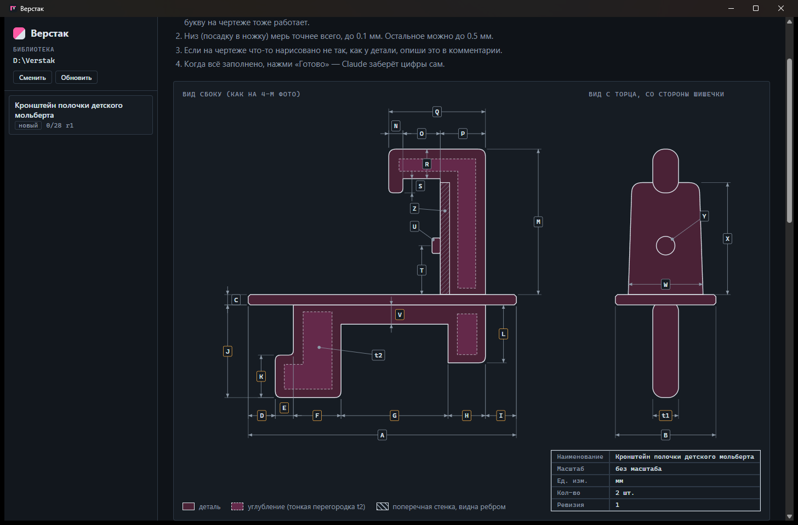

# Верстак

**Вайбкод для 3D-печати деталей.** Фотографируешь сломанную или нужную деталь, Claude рисует по фото чертёж с буквенными размерами, ты меряешь деталь штангенциркулем прямо в приложении, Claude забирает цифры и строит модель в OpenSCAD, ты печатаешь.



```
фото детали ──► Claude: чертёж под замер ──► Верстак: ты вводишь замеры
                                                       │
        печать ◄── STL ◄── Claude: модель OpenSCAD ◄───┘  (цифры из файла, без копипасты)
```

Верстак — настольное приложение для Windows (один exe на ~3 МБ). Связь с Claude идёт только через файлы в папке библиотеки, поэтому подойдёт любой Claude, который умеет читать и писать файлы: Claude Code, десктопное приложение Claude, агент в IDE.

---

## Как пользоваться

### 1. Установка

Нужны Windows 10/11 (WebView2 там уже есть) и, для модели, [OpenSCAD](https://openscad.org/downloads.html).

Скачай `verstak.exe` со страницы [Releases](https://github.com/sorokin2486/verstak/releases/latest) и положи куда удобно, установка не нужна. Exe не подписан: если Windows покажет «Система Windows защитила ваш компьютер», нажми «Подробнее» → «Выполнить в любом случае». Можно и собрать самому, см. [Сборка](#сборка).

### 2. Научи Claude работать с Верстаком

Скопируй папку [`claude/skills/verstak`](claude/skills/verstak) в `%USERPROFILE%\.claude\skills\`:

```powershell
Copy-Item -Recurse claude\skills\verstak "$env:USERPROFILE\.claude\skills\"
```

В скилле описано, куда класть чертежи, как их проверять и как забирать замеры. Если Верстак лежит не в `D:\Projects\verstak`, поправь путь в начале `SKILL.md`.

Без Claude Code тоже можно: дай Claude файл [docs/format.md](docs/format.md) и скажи, в какую папку класть чертёж.

### 3. Первый запуск

Запусти `verstak.exe`. Слева будет **библиотека**: по умолчанию `D:\Verstak` (если диска D: нет — `Документы\Verstak`). Путь меняется кнопкой «Сменить».

Каждая деталь — отдельная подпапка библиотеки. Приложение следит за папкой само: новая деталь или новая версия чертежа появляется без перезапуска.

### 4. Попроси Claude сделать чертёж

Пришли фото детали (лучше 3–5 штук с разных сторон, рядом линейка или монета для масштаба) и напиши, например:

> Сделай чертёж под замер этого кронштейна в Верстаке. Посадка в ножку мольберта — самое важное.

Claude создаст `D:\Verstak\<деталь>\drawing.json`, проверит его и посмотрит превью. Деталь появится в списке слева.

### 5. Измерь деталь

- Нажми на поле с буквой: на чертеже подсветится, что именно мерить. Нажатие на букву на чертеже тоже работает.
- Вводи числа как есть: запятая сама станет точкой. Для сужающихся мест можно писать `40/38`.
- Оранжевая рамка группы — посадочные размеры, их мерь точнее всего, до 0.1 мм.
- Если введённое число сильно отличается от того, что Claude оценил по фото, под полем появится предупреждение: обычно это перепутанные мм и см.
- Всё сохраняется само, кнопки «Сохранить» нет.
- В **комментарии** напиши, что нарисовано не так, куда деталь вставляется, принтер, сопло и пластик.
- Когда закончишь, нажми **«Готово, передать Claude»**.

### 6. Попроси модель

> Замеры кронштейна готовы, построй модель.

Claude прочитает `measurements.json`, сверит проверочные суммы (например, «A = D+E+F+G+H+I»), напишет `model.scad`, отрендерит его для проверки и сделает STL. Слайсь и печатай.

### Если чертёж надо поправить

Скажи Claude, что не так («у зуба есть фаска», «шишечки с другой стороны нет»). Он выпустит **новую ревизию** чертежа. В Верстаке появится баннер «ревизия 1 → 2» со списком новых и убранных размеров:

- уже введённые значения сохраняются;
- значения убранных размеров видны внизу, в блоке «Значения из прошлых ревизий»;
- у каждого размера есть **история** изменений (ссылка «история · N» под полем);
- все версии чертежа лежат в `.history` внутри папки детали.

---

## Файлы детали

```
D:\Verstak\easel-bracket\
  drawing.json        чертёж — пишет только Claude
  measurements.json   замеры — пишет только Верстак
  photo.jpg           необязательно
  model.scad, *.stl   модель
  .history\           прошлые ревизии чертежа
```

Формат обоих файлов: [docs/format.md](docs/format.md). Пример чертежа: [examples/easel-bracket](examples/easel-bracket/drawing.json).

## Инструменты для Claude

```powershell
node tools/validate.ts D:\Verstak\easel-bracket                    # проверка чертежа
node tools/preview.ts  D:\Verstak\easel-bracket out.png --active A # PNG тем же рендерером, что в приложении
```

## Сборка

Нужны [Node.js](https://nodejs.org/) 24+, [Rust](https://rustup.rs/) и Visual Studio Build Tools (C++).

```powershell
npm install
npm run exe     # → src-tauri\target\release\verstak.exe
```

Разработка:

```powershell
npm run tauri dev   # приложение с горячей перезагрузкой
npm run dev         # только интерфейс в браузере, на демо-данных
npm test            # тесты ядра (vitest)
cargo test --manifest-path src-tauri/Cargo.toml
```

## Устройство

Tauri 2 (Rust) + Vite + TypeScript без фреймворка, движок WebView2. Тёмная тема.

```
src/core/      формат, проверка, рендерер JSON→SVG, логика замеров (без DOM, общий для приложения и tools)
src/app/       интерфейс: библиотека, окно детали, связь с Rust
src-tauri/     чтение и атомарная запись файлов, слежение за папкой, настройки
tools/         validate.ts, preview.ts
claude/skills/ скилл для Claude Code
```
